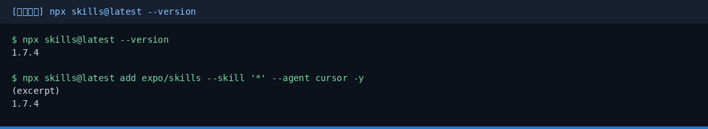
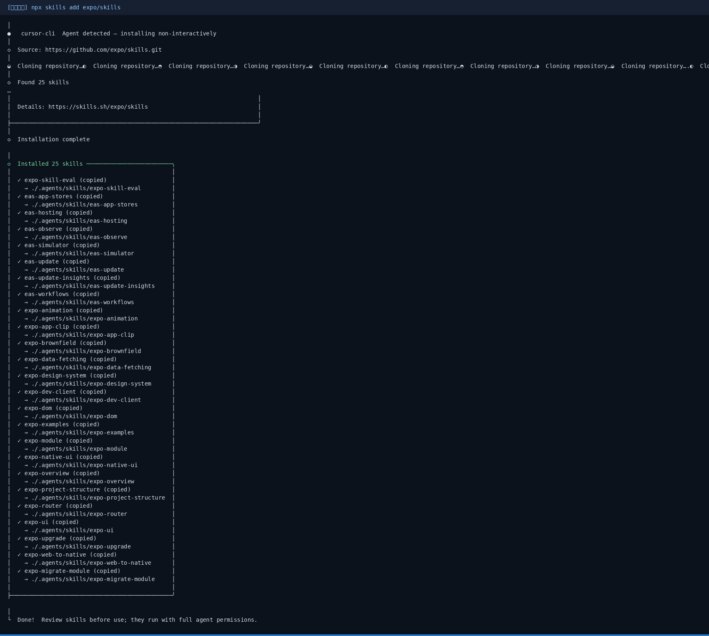
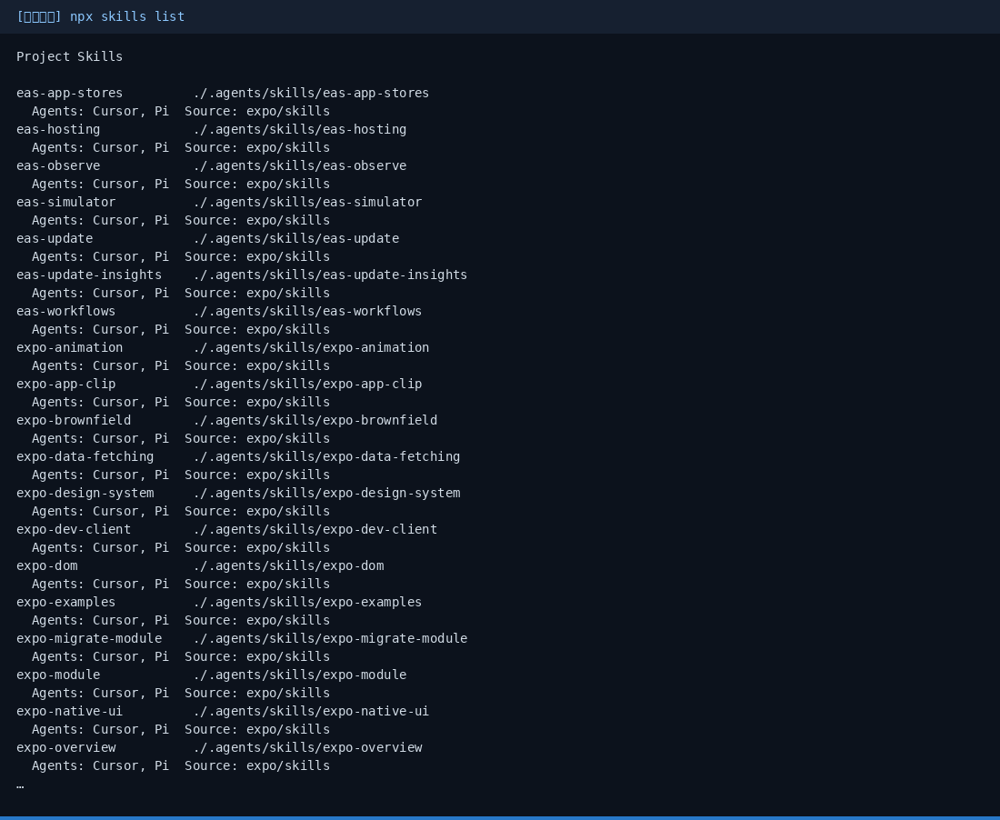
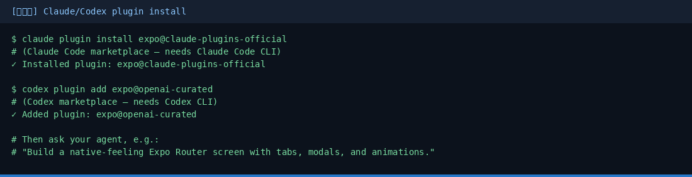

# Expo Skills 小白中文教程

> Expo 官方 AI Agent Skills 入门（社区非官方教程）  
> 上游：[`expo/skills`](https://github.com/expo/skills) · 文档：[docs.expo.dev/skills](https://docs.expo.dev/skills)  
> 教程校对日期：2026-10-29（Asia/Shanghai）· 本机实测 **skills CLI 1.7.4**，一次装入 **25** 个 Expo skills

[](https://github.com/xianyu110/awesome-expo-skills-zh)
[](https://github.com/expo/skills)
[](LICENSE)
[](https://xianyu110.github.io/awesome-expo-skills-zh/)

---

## 截图索引

| # | 文件 | 类型 | 说明 |
|---|------|------|------|
| 1 | [`images/01-version.png`](images/01-version.png) | **真实** | `npx skills@latest --version` → 1.7.4 |
| 2 | [`images/02-install.png`](images/02-install.png) | **真实** | `npx skills add expo/skills --skill '*'` 安装完成（25 skills） |
| 3 | [`images/03-list.png`](images/03-list.png) | **真实** | `npx skills list` 项目内技能列表 |
| 4 | [`images/04-plugins-schematic.png`](images/04-plugins-schematic.png) | **示意图** | Claude Code / Codex 官方插件安装（本机无对应 CLI） |

> 真实截图在 Linux 沙盒用 Node 22 + npx 采集；路径已脱敏为 `<project>`。

---

## 这是什么？

**Expo Skills** 是 Expo 团队维护的**官方 AI agent skills**：帮代理在正确时机使用 Expo / EAS / React Native 约束，构建、部署、升级与调试 Expo 应用。

- 文档、Expo CLI、EAS CLI 仍是权威来源；skills 负责让代理**少踩坑**
- 安装路径分两类：**Skills CLI**（Cursor 等）与 **官方插件市场**（Claude Code / Codex）
- 技能分「Start Here / Framework（开源）/ Services（可能涉及付费 EAS）」等组——以官方 README 表格为准

本仓库只提供**中文小白教程**（MIT），不二次分发上游 skill 正文（请用官方安装命令拉取最新版）。

---

## 官方链接（请以官方为准）

| 资源 | 链接 |
|------|------|
| 文档 | https://docs.expo.dev/skills |
| 源码 | https://github.com/expo/skills |
| skills.sh 安装页 | https://skills.sh/expo/skills |
| Skills CLI 文档 | https://skills.sh/docs/cli |

---

## 安装路径怎么选？

| 路径 | 适合 |
|------|------|
| **Skills CLI** | Cursor、OpenCode、GitHub Copilot、Windsurf、Gemini、Cline 等 |
| **Claude Code 插件** | Claude Code（官方 marketplace 自动更新） |
| **Codex 插件** | Codex（OpenAI-curated marketplace） |

---

## 安装：Skills CLI（macOS / Windows / Linux）

在**项目根目录**执行（官方 README）：

```bash
npx skills@latest add expo/skills --skill '*'
```

- `--skill '*'`：选中全部 Expo skills，而不是乱选其他包
- CLI 仍会询问装到哪些 agent；可加 `--agent cursor`（或你的代理名）直接指定
- 多数场景再加 `-y` 可非交互确认（以当前 CLI 帮助为准）

本机真实版本与安装：





安装后可检查：

```bash
npx skills@latest list
# 常见落盘：./.agents/skills/<skill-name>/SKILL.md
```



更新：

```bash
npx skills@latest update
# 或更新单个：npx skills@latest update expo-router
```

装完后**重启 / 刷新**代理会话，以便发现新的 `SKILL.md`。

---

## 安装：Claude Code / Codex 插件（示意图）

本教程沙盒未安装 Claude Code / Codex CLI，以下命令来自官方 README，界面以你本机为准：

```bash
# Claude Code
claude plugin install expo@claude-plugins-official
# 或在 Claude Code 内：/plugin install expo@claude-plugins-official

# Codex
codex plugin add expo@openai-curated
# 或在 Codex 内打开 /plugins，从 OpenAI-curated 安装 expo
```



插件路径的更新走各自官方 marketplace，不必手跑 `skills update`。

---

## 第一次演示任务（约 5 分钟）

1. 在已有 Expo 项目根目录装好 skills（见上）。
2. 重启 Cursor / 你的 agent。
3. 用自然语言提一个**具体** Expo 任务，例如官方示例：
   - 「Build a native-feeling Expo Router screen with tabs, modals, and animations.」
   - 「Create an EAS workflow that builds previews on pull requests.」
   - 「Help me upgrade this app to the latest Expo SDK.」
   - 「Check whether this EAS Update rollout is healthy.」
4. 代理会按任务描述匹配 skill（如 `expo-router`、`eas-workflows`、`expo-upgrade` 等）。**不要编造菜单名**——以你 IDE 实际面板为准。
5. 涉及 EAS 付费能力时，先看官方费用 / 套餐说明；本教程不报价。

---

## 常见报错与处理

| 现象 | 可能原因 | 处理 |
|------|----------|------|
| `npx` 很慢 / 要确认 | 首次拉 `skills` 包 | 用 `npx --yes skills@latest …`；保持网络畅通 |
| 装完代理不认 skill | 未刷新会话 | 重启 agent / 重开窗口；确认 `./.agents/skills` 存在 |
| 只想装某一个 | 不必 `*` | `npx skills@latest add expo/skills --skill expo-router` |
| Claude/Codex 命令找不到 | 未装对应 CLI | 先装 Claude Code / Codex，或改用 Skills CLI |
| 与文档不一致 | 上游迭代 | 以 [docs.expo.dev/skills](https://docs.expo.dev/skills) 与仓库 README 为准 |

---

## 模型 / API 合规说明（国内读者）

- Expo Skills 教的是 **Expo / EAS 工作流**，本身不强制某一家境外大模型。
- 本教程**不硬推**未备案境外模型或中转。代理背后用哪家模型由你本地 IDE 配置决定；需要 OpenAI 兼容入口时可自行评估 Ollama / 国内兼容端或 [TryAllAPI](https://tryallapi.com/register?aff=5A6A)（轻提示）。
- 店铺（可选）：[https://wzyp.cn/shop/maynorai](https://wzyp.cn/shop/maynorai)

---

## 许可证说明

| 内容 | 协议 |
|------|------|
| **本教程文案** | [MIT](LICENSE) |
| **expo/skills 上游** | [MIT](https://github.com/expo/skills)（见上游仓库） |

与 Expo / Expo Application Services **无官方隶属关系**。

---

## 维护

- 作者：Maynor（[@xianyu110](https://github.com/xianyu110) / Maynor996）
- 上游问题：https://github.com/expo/skills/issues
- 在线页：https://xianyu110.github.io/awesome-expo-skills-zh/
